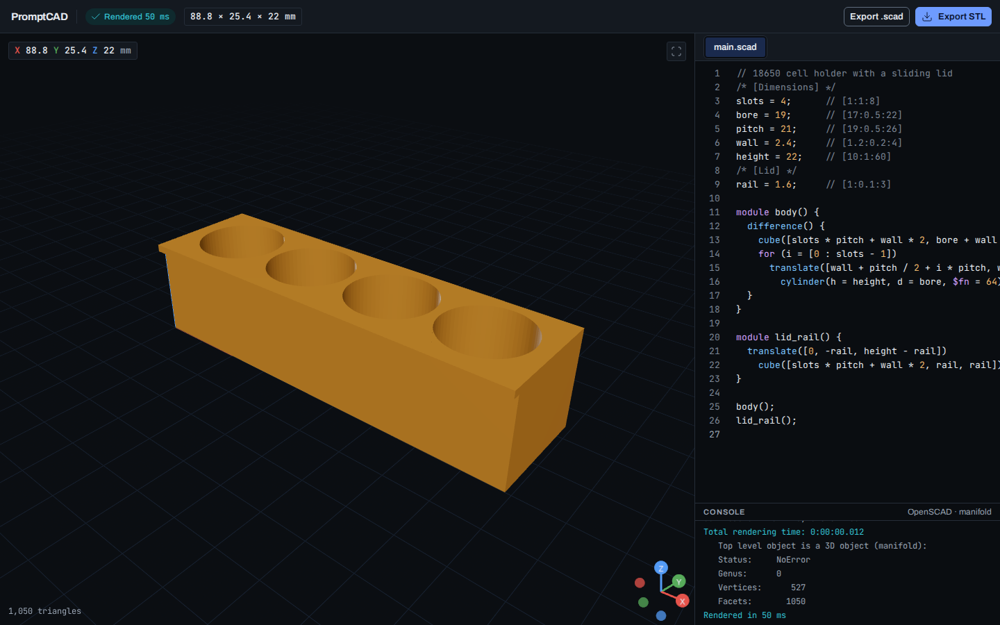

# ChatSCAD

**Try it:** https://meyhem.github.io/chatscad/

Describe a part, tune it, print it. ChatSCAD is a CAD workbench that runs entirely in your browser: you write (and soon, describe) a model in OpenSCAD, it compiles on your own device, and you download an STL for your 3D printer. Nothing is uploaded and there is no account.



## What you can do today

ChatSCAD is being built in milestones. The first one, the render core, is done:

- **Write or paste OpenSCAD** in a code editor with syntax highlighting. The model re-renders about half a second after you stop typing.
- **See it in 3D.** Orbit, pan and zoom. The camera frames the first render and then stays where you put it. The size of the part is always shown in millimetres.
- **Find mistakes fast.** A failed compile names the line in the status pill, marks it in the editor with the error underneath, and keeps your last good model on screen.
- **Export** a binary STL for your slicer, or the `.scad` source. On phones and tablets the share sheet opens, so you can send the file straight to a slicer app.
- **Work offline-friendly and private.** OpenSCAD itself runs in your browser as WebAssembly. Your code never leaves the page.

## Example: a holder for 18650 cells

Open the app, replace the starter code with this, and you get the holder from the screenshot above:

```openscad
// 18650 cell holder with a sliding lid
/* [Dimensions] */
slots = 4;      // [1:1:8]
bore = 19;      // [17:0.5:22]
pitch = 21;     // [19:0.5:26]
wall = 2.4;     // [1.2:0.2:4]
height = 22;    // [10:1:60]
/* [Lid] */
rail = 1.6;     // [1:0.1:3]

module body() {
  difference() {
    cube([slots * pitch + wall * 2, bore + wall * 2, height]);
    for (i = [0 : slots - 1])
      translate([wall + pitch / 2 + i * pitch, wall + bore / 2, wall])
        cylinder(h = height, d = bore, $fn = 64);
  }
}

module lid_rail() {
  translate([0, -rail, height - rail])
    cube([slots * pitch + wall * 2, rail, rail]);
}

body();
lid_rail();
```

Change `slots = 4;` to `slots = 6;` and the holder grows to six cells. When it looks right, press **Export STL** and open the file in your slicer.

If you make a typo, ChatSCAD tells you where. Here a `)` is missing after `translate([…]`:


## What is coming

- **Chat with an AI model** to create and change parts in plain words, with automatic fixes when the generated code does not compile. You bring your own key for Anthropic, OpenAI, OpenRouter, or a local model such as Ollama. Keys stay on your device.
- **Sliders for every parameter**, version history you can restore or branch from, and a gallery of starter models.
- **Phone layout and offline install**, three variants per prompt to pick from, voice prompts, share links, PNG and turntable GIF export.
- **Tap a part to change just that part**, and start from a photo or a sketch.

The full plan is in the [technical spec](docs/SPEC.md).

## Run it yourself

You need Node.js 24 or newer.

```bash
npm install
```

```bash
npm run dev
```

The first run downloads the pinned OpenSCAD WebAssembly build (about 11 MB) into `public/openscad/` and checks its SHA-256. To build static files for any web host:

```bash
npm run build
```

The output in `dist/` is plain static files. Set `BASE_PATH` when the app lives under a sub-path, for example `BASE_PATH=/chatscad/ npm run build`.

## Privacy

There is no server. Rendering, storage and, later, AI calls all happen in your browser. The page loads no third-party scripts, fonts or analytics, and a strict Content Security Policy enforces that.
