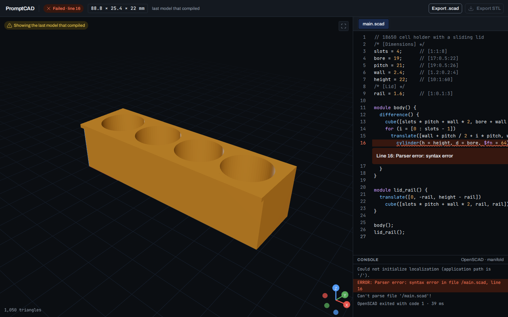

# ChatSCAD

**Try it:** https://meyhem.github.io/chatscad/

Describe a part, tune it, print it. ChatSCAD is a CAD workbench that runs entirely in your browser: an AI model writes OpenSCAD for you, it compiles on your own device, and you download the result for your 3D printer. There is no server and no account.

- **Model from pictures or from scratch.** Start from one or more photos of a real object, a drawing or a sketch, or describe a new part in plain words (or write the OpenSCAD yourself).
- **Bring your own model.** Many API-based providers work out of the box: Anthropic, OpenAI, OpenRouter, any OpenAI-compatible endpoint, or a local model such as Ollama. Keys stay on your device.
- **Agentic flow with review.** The agent plans checks for the part, builds it, renders four views and reviews them against the checks, then proposes fixes round after round.
- **Various exports.** Binary STL, the `.scad` source, a PNG, a turntable GIF, or a share link.


The cartridge above was modelled from four phone photos and one sentence ("its about 50mm tall and 10mm in diameter") with GPT 6 SOL, on the first try, for $0.038 in total.

## What you can do

- **Ask for a part, or a change to it.** Bring your own key for Anthropic, OpenAI, OpenRouter or any OpenAI-compatible endpoint, or use a local model such as Ollama. Keys stay on your device. Code that fails to compile goes back to the model automatically.
- **Choose Edit or Agent for each request.** Edit sends one quick change. Agent, with a model that takes images, plans checks for the part, builds it, renders four views with each part in its own colour, reviews them against the checks and proposes fixes for you to approve, round after round. Each run is grouped in the chat with its steps.
- **Tune it with sliders.** Every model is parametric: parameters become sliders with units, with presets and "Bake into code".
- **Tap a part to change just that part**, or start from a photo, a drawing or a sketch.
- **Start a project from photos** of a real object: one photo or several angles, a description and a scale. Every size in the model says where it came from (the description, a photo or a guess), and you can add angles later and refine.
- **Ask for three variants** of a request and keep the one you like. Dictate prompts with your voice.
- **Go back in time.** Every change is a version you can preview, compare, restore or branch from.
- **Edit the code by hand** in an OpenSCAD editor with highlighting and inline errors. The model re-renders about half a second after you stop typing, and a failed compile keeps your last good model on screen.
- **See it in 3D** with the size in millimetres, and export a binary STL, the `.scad` source, a PNG or a turntable GIF. Share a model as a link.
- **Use it on a phone**, install it, and keep working offline. Start from the gallery of example models.

## Example: a holder for 18650 cells

Open the app, replace the code with this (or ask the agent for it), and you get a holder for four cells:

```openscad
// 18650 cell holder with a sliding lid
/* [Dimensions] */
slots = 4;      // [1:1:8]
bore = 19;      // [17:0.5:22]
pitch = 21;     // [19:0.5:26]
wall = 2.4;     // [1.2:0.2:4]
height = 22;    // [10:1:60]
/* [Lid] */
rail = 1.6;     // [1:0.1:3]

module body() {
  difference() {
    cube([slots * pitch + wall * 2, bore + wall * 2, height]);
    for (i = [0 : slots - 1])
      translate([wall + pitch / 2 + i * pitch, wall + bore / 2, wall])
        cylinder(h = height, d = bore, $fn = 64);
  }
}

module lid_rail() {
  translate([0, -rail, height - rail])
    cube([slots * pitch + wall * 2, rail, rail]);
}

body();
lid_rail();
```

Drag the `slots` slider to 6, or change `slots = 4;` to `slots = 6;`, and the holder grows to six cells. When it looks right, press **Export STL** and open the file in your slicer.

If you make a typo, ChatSCAD tells you where. Here a `)` is missing after `translate([…]`:



The full plan is in the [technical spec](docs/SPEC.md).

## Run it yourself

You need Node.js 24 or newer.

```bash
npm install
```

```bash
npm run dev
```

The first run downloads the pinned OpenSCAD WebAssembly build (about 11 MB) into `public/openscad/` and checks its SHA-256. To build static files for any web host:

```bash
npm run build
```

The output in `dist/` is plain static files. Set `BASE_PATH` when the app lives under a sub-path, for example `BASE_PATH=/chatscad/ npm run build`.

## Privacy

There is no server. Rendering and storage happen in your browser, and AI requests go straight from your browser to the provider you chose. The page loads no third-party scripts, fonts or analytics, and a strict Content Security Policy enforces that.
